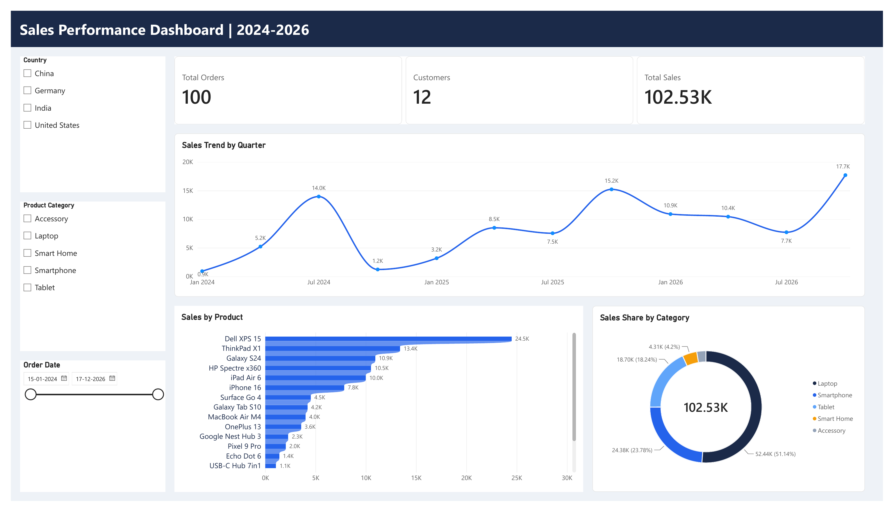

# Sales Performance Dashboard (Power BI)

A one-page Power BI dashboard for an electronics store. It shows how much the business sells, who buys, which products drive revenue and how sales move over time from January 2024 to December 2026.



## Business questions

1. How big is the business: how many orders, customers and how much revenue?
2. Is sales growing over time, and where are the dips?
3. Which products bring in the most revenue?
4. Which product categories make up the revenue mix?
5. How do these numbers change by country, category and date range?

## Data

Two related tables, loaded from CSV files (semicolon-separated):

| Table | Rows | Columns |
| --- | --- | --- |
| `orders` | 100 | order_id, order_date, customer_id, product_name, product_category, quantity, sales |
| `customers` | 12 | customer_id, first_name, last_name, country, state, city, score |

Practice dataset from the Data with Baraa Power BI course materials.

## How I built it

**1. Data preparation (Power Query)**
- Loaded both CSV files and checked the detected data types.
- Merged `first_name` and `last_name` into one `customer name` column (Merge Columns, space separator).

**2. Data checks and formatting (Table view)**
- Shortened the `order_date` format and added a thousands separator to `sales`.
- `score` had blank values, so I added a calculated column that replaces blanks with 0:

```DAX
clean score = COALESCE(customers[score], 0)
```

**3. Data model (Model view)**
- One-to-many relationship: `customers[customer_id]` (1) → `orders[customer_id]` (*). One customer can place many orders.

**4. Report (Report view)**

| Visual | Fields | Answers |
| --- | --- | --- |
| KPI cards | Count of orders, distinct count of customers, sum of sales | Q1 |
| Line chart | Sales by order date (Year → Quarter drill-down) | Q2 |
| Bar chart | Sales by product, sorted highest first | Q3 |
| Donut chart | Sales share by product category | Q4 |
| Slicers | Country (list), Product Category (list), Order Date (between range) | Q5 |

Design: navy header, one blue for every sales measure so the colour always means "sales", light grey page background and amber used only as a highlight colour in the category mix.

## Key insights

- **Size:** 100 orders from 12 customers, worth $102.5K in total.
- **Growth:** yearly sales rose from $21.3K (2024) to $34.5K (2025) to $46.8K (2026). The strongest quarter is the last one, at $17.7K.
- **Where the growth came from:** filtering by country shows China jumped from $7.1K to $19.4K in 2026 (+174%) while the US fell from $27.2K to $23.5K (-14%). Without China, 2026 would have been a down year, and China's sales come from only 2 customers.
- **Products:** Dell XPS 15 alone brings in $24.5K, about 24% of all revenue and almost double the next product (ThinkPad X1, $13.4K).
- **Category mix:** Laptops are 51% of revenue ($52.4K). Smartphones (24%) and Tablets (18%) follow, while Smart Home and Accessories together are under 7%.
- **Countries:** the United States accounts for 68 of the 100 orders and $66.0K (64%) of sales. China is second with $30.8K.
- **Customers:** the top 4 of 12 customers bring 58% of sales, a clear concentration risk.
- **Order value:** a laptop order averages $1,942; accessories and smart-home items average $190, though every customer buys them. They work best as add-ons to bigger purchases.

The full write-up, with charts, four filtered views of the dashboard and recommendations, is in [Sales_Performance_Report.pdf](Sales_Performance_Report.pdf).

## Files

| File | What it is |
| --- | --- |
| `Sales_Performance_Dashboard.pbix` | The Power BI file (data, model and report) |
| `Sales_Performance_Report.pdf` | 9-page report: findings, charts, filtered views, recommendations |
| `Sales_Performance_Dashboard.pdf` | PDF export of the dashboard |
| `dashboard.png` | Dashboard screenshot |

## How to open

Download `Sales_Performance_Dashboard.pbix` and open it in [Power BI Desktop](https://www.microsoft.com/en-us/power-platform/products/power-bi/desktop) (free, Windows). Click any bar, slice or slicer item to filter the whole page.

**Tools:** Power BI Desktop · Power Query · DAX
